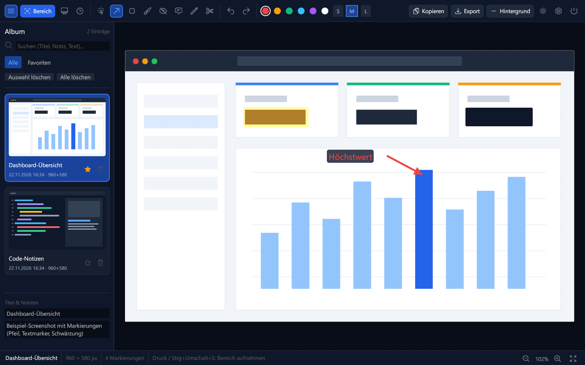
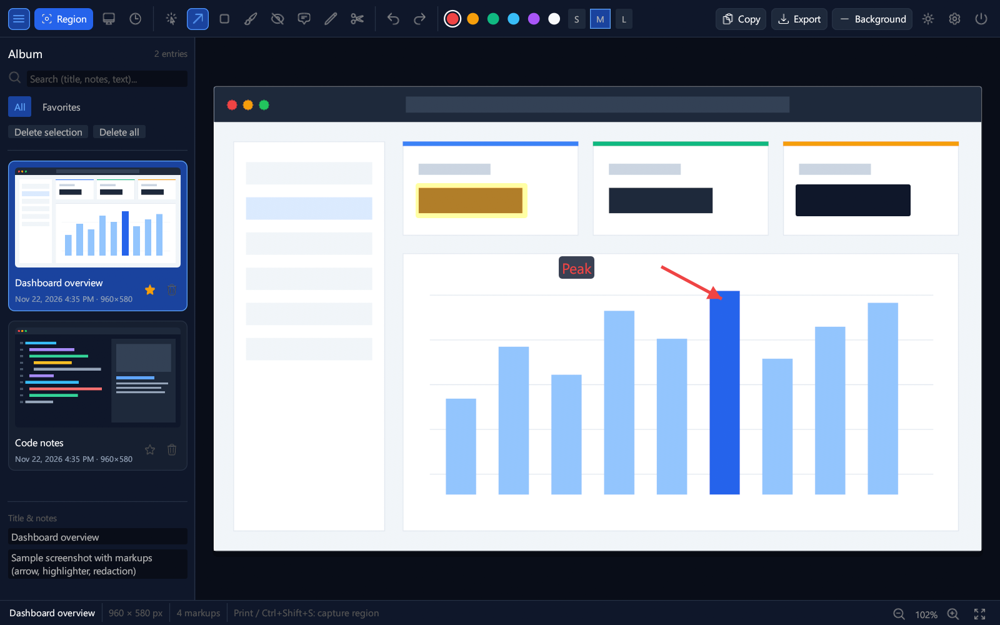

# Z-SHOT

Screenshot-Werkzeug für Windows, geschrieben in Rust und egui. Es läuft im Hintergrund mit einem Symbol im Infobereich, nimmt per Tastenkürzel einen Bildschirmbereich auf und öffnet ihn danach im Editor oder speichert ihn direkt.

*[English version below](#english)*



## Download

Die aktuelle Version gibt es unter **[Releases](https://github.com/RayTrunk/Z-SHOT/releases/latest)** als `Z-SHOT-Setup-<Version>.exe`.

- Installation ohne Administratorrechte nach `%LOCALAPPDATA%\Programs\Z-SHOT`
- Der Installer ist deutsch und englisch, die Sprache richtet sich nach Windows
- Autostart mit Windows lässt sich im Installer und später in den Einstellungen wählen
- Ein Update installiert man einfach über die vorhandene Version; das Album bleibt erhalten, auch beim Deinstallieren

Die Setup-Datei ist nicht signiert. Windows SmartScreen zeigt deshalb beim ersten Start eventuell eine Warnung („Weitere Informationen“ → „Trotzdem ausführen“).

## Linux (Vorschau)

Ab der nächsten Version gibt es Z-SHOT auch für Linux, als `z-shot-<Version>-linux-x86_64.tar.gz` unter Releases. Diese Version ist neu und auf echten Desktops noch wenig getestet.

- Läuft unter Wayland und X11. Bildschirmfotos, Tastenkürzel und Dateidialoge gehen über die Desktop-Portale (`xdg-desktop-portal`), wie es Wayland verlangt. Beim ersten Mal fragt die Arbeitsumgebung nach der Erlaubnis.
- Symbol im Infobereich unter KDE; unter GNOME mit der Erweiterung „AppIndicator and KStatusNotifierItem Support“.
- Fehlt das Tastenkürzel-Portal, legt man in den Tastatur-Einstellungen ein eigenes Kürzel mit `z-shot --capture region` an.
- Album und Einstellungen liegen in `~/.local/share/z-shot`, Screenshots standardmäßig in `Bilder/Z-SHOT`.

Hinweise zur Installation stehen in [`packaging/linux/LIESMICH.txt`](packaging/linux/LIESMICH.txt). Ein Flatpak ist [vorbereitet](packaging/flatpak/).

## Funktionen

- Bereichsauswahl per Tastenkürzel, Standard `Druck` und `Strg+Umschalt+S`, frei belegbar mit automatischer Tastenerkennung; optional ein Kürzel für Vollbild
- Nach der Auswahl: Editor öffnen, direkt speichern oder beides; optional zusätzlich in die Zwischenablage
- Speicherort `Bilder\Z-SHOT`, Dateiname nach Datum und Uhrzeit (`2026-11-21_14-05-33.png`)
- Editor mit Pfeil, Rechteck, Textmarker, Schwärzen, Text, Freihand und Zuschnitt; Rückgängig/Wiederholen
- Album mit Suche, Favoriten, Titeln und Notizen; einzelne, ausgewählte (Strg+Klick) oder alle Einträge löschen
- Mehrere Bildschirme mit unterschiedlicher Skalierung
- Oberfläche auf Deutsch und Englisch, passend zur Windows-Anzeigesprache
- Hinweis auf neue Versionen (siehe unten)

## Update-Prüfung

Z-SHOT fragt kurz nach dem Start und danach höchstens einmal am Tag bei GitHub (`api.github.com`) nach, ob es eine neuere Version gibt. Wenn ja, erscheint unten rechts ein Hinweis mit Link zur Download-Seite. Es wird nichts automatisch heruntergeladen oder installiert, und außer der Anfrage selbst werden keine Daten übertragen. Die Prüfung lässt sich schon im Installer und später in den Einstellungen unter „Allgemein“ abschalten; unter „Über Z-SHOT“ kann man jederzeit von Hand prüfen.

## Datenschutz

Z-SHOT arbeitet lokal. Screenshots, Album, Notizen und Einstellungen bleiben auf dem eigenen Rechner (`%LOCALAPPDATA%\Z-SHOT` bzw. unter Linux `~/.local/share/z-shot`, dazu der gewählte Speicherordner) und werden nirgendwohin übertragen.

Die einzige Verbindung ins Internet ist die oben beschriebene Update-Prüfung: eine HTTPS-Anfrage an `api.github.com` mit der Kennung `Z-SHOT/<Version>`. Dabei erfährt GitHub wie bei jedem Webseitenaufruf die IP-Adresse; dafür gilt die [Datenschutzerklärung von GitHub](https://docs.github.com/site-policy/privacy-policies/github-general-privacy-statement). Der Installer fragt, ob die Prüfung aktiv sein soll; in den Einstellungen lässt sie sich jederzeit ändern.

## Bauen

Voraussetzung: [Rust](https://rustup.rs) (stable, MSVC).

```
cd app
cargo build --release
```

Die Exe liegt danach unter `app/target/release/z-shot.exe`.

Den Installer baut `installer\build.ps1`; dafür wird zusätzlich [Inno Setup](https://jrsoftware.org/isinfo.php) 6 oder 7 benötigt. Das Ergebnis liegt in `installer\Output\`.

## Lizenz

Copyright (C) 2026 R. Trunk

Dieses Programm ist freie Software: Sie können es unter den Bedingungen der GNU General Public License, wie von der Free Software Foundation veröffentlicht, weitergeben und/oder modifizieren, entweder gemäß Version 3 der Lizenz oder (nach Ihrer Wahl) jeder späteren Version. Es wird ohne jede Gewährleistung bereitgestellt. Den vollständigen Lizenztext finden Sie in [LICENSE](LICENSE).

## Drittanbieter

- Icons: [Heroicons](https://heroicons.com) v2.2.0, © Tailwind Labs, Inc., MIT-Lizenz (siehe `app/assets/heroicons/LICENSE`)

---

## English

Z-SHOT is a screenshot tool for Windows, written in Rust and egui. It runs in the background with a tray icon, captures a screen region with a hotkey, and then opens it in the editor or saves it right away.



**Download:** get `Z-SHOT-Setup-<version>.exe` from **[Releases](https://github.com/RayTrunk/Z-SHOT/releases/latest)**. It installs without admin rights to `%LOCALAPPDATA%\Programs\Z-SHOT`, and you can choose there whether Z-SHOT starts with Windows. To update, install the new version over the old one; your album is kept, even when uninstalling. The setup is not code-signed, so Windows SmartScreen may warn on first launch ("More info" → "Run anyway").

**Linux (preview):** from the next release on there is a Linux build, `z-shot-<version>-linux-x86_64.tar.gz` under Releases. It runs on Wayland and X11 and takes screenshots, shortcuts and file dialogs through the desktop portals (`xdg-desktop-portal`); the desktop asks for permission the first time. The tray icon needs KDE, or GNOME with the AppIndicator extension. Without the GlobalShortcuts portal, bind `z-shot --capture region` to a key in your desktop's keyboard settings. This build is new and has seen little testing on real desktops yet.

**Features:** region capture with configurable hotkeys (default `Print` and `Ctrl+Shift+S`), optional fullscreen hotkey; open the editor, save directly or both, optionally also copy to the clipboard; editor with arrow, rectangle, highlighter, redaction, text, freehand and crop, with undo/redo; album with search, favourites, titles and notes; multiple monitors with different scaling; German and English UI, following the Windows display language.

**Update check:** shortly after start and then at most once a day, Z-SHOT asks GitHub (`api.github.com`) whether a newer version exists and shows a notice in the bottom right if so. Nothing is downloaded or installed automatically, and nothing is sent besides the request itself. You can turn it off in Settings → General, or check by hand under About Z-SHOT.

**Privacy policy:** Z-SHOT works locally. Screenshots, album, notes and settings stay on your computer and are never transmitted. The only network connection is the update check described above: one HTTPS request to `api.github.com` with the user agent `Z-SHOT/<version>`, which, like any web request, reveals your IP address to GitHub ([GitHub privacy statement](https://docs.github.com/site-policy/privacy-policies/github-general-privacy-statement)). The installer asks whether to enable it, and it can be changed in the settings at any time.

**Build:** `cd app && cargo build --release` (needs Rust stable, MSVC). The installer is built with `installer\build.ps1` (needs Inno Setup 6 or 7).

**License:** Copyright (C) 2026 R. Trunk. Free software under the [GNU General Public License v3 or later](LICENSE), with ABSOLUTELY NO WARRANTY. Icons: [Heroicons](https://heroicons.com), MIT license.

## Code signing policy

Free code signing provided by [SignPath.io](https://about.signpath.io), certificate by [SignPath Foundation](https://signpath.org)

- Releases are built from this repository by the GitHub Actions workflow [`release.yml`](.github/workflows/release.yml) on GitHub-hosted runners; only those builds are submitted for signing.
- Every signing request is approved by hand.
- Team roles:
  - Committers and reviewers: [RayTrunk](https://github.com/RayTrunk)
  - Approvers: [RayTrunk](https://github.com/RayTrunk)
- Privacy policy: see [Datenschutz](#datenschutz) / *Privacy policy* above.

Signed releases start with the first version built after SignPath approved the project; earlier releases (up to 0.9.1) are not signed.
